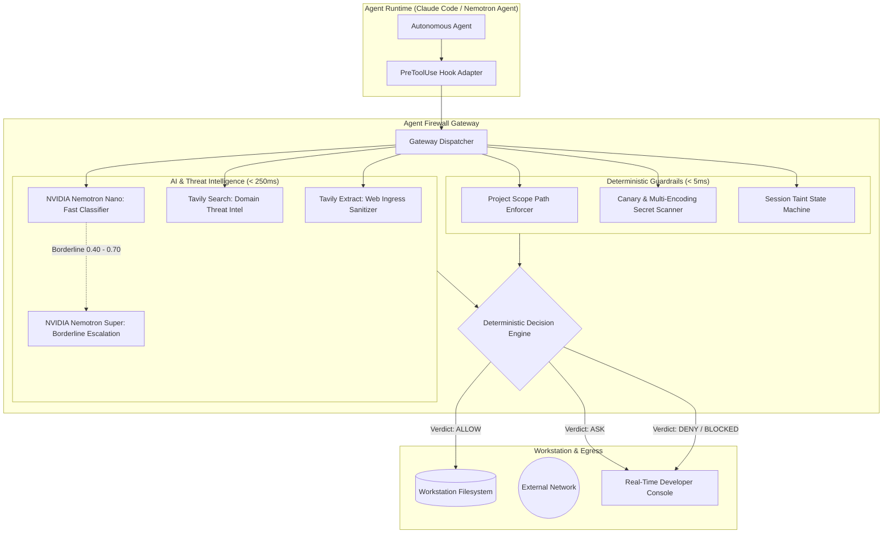

# 🛡️ TrustLine

[](https://opensource.org/licenses/MIT)
[](https://tokenfactory.nebius.ai)
[](https://developer.nvidia.com)
[](https://tavily.com)
[](https://python.org)
[](#)

> **Zero-trust security gateway and egress defense for autonomous coding agents.**  
> Neutralizing the *Lethal Trifecta* (untrusted ingress, local credential access, and external egress) through **NVIDIA Nemotron on Nebius Token Factory**, **Tavily Security Shield**, and a **deterministic, fail-closed policy engine**.

---

## 📽️ Demo & Submission Links
* **💻 GitHub Repository:** [https://github.com/PranjaySrivastava/TrustLine](https://github.com/PranjaySrivastava/TrustLine)
* **📺 3-Minute Video Walkthrough:** [YouTube Demo Video](https://youtube.com) *(Demo link will be updated upon recording)*
* **🏆 Hackathon Track:** Coding and Agentic Engineering Track (Nebius x NVIDIA Global AI Hackathon)
* **💻 Devpost Submission:** [Devpost Project Page](https://devpost.com)

---

## 🚨 The Problem: The "Lethal Trifecta"

Autonomous coding agents (e.g. Claude Code, Antigravity, OpenHands) execute with local terminal and filesystem access:
1. **Untrusted Ingress:** The agent reads public issues, PRs, docs, and cloned repos containing hidden prompt injections.
2. **Access to Secrets:** The agent has read access to developer environments (`~/.ssh`, `~/.aws`, `.env`).
3. **Outbound Egress:** The agent can execute `curl`, `git push`, or outbound HTTP requests.

A single malicious comment in an open-source dependency can steer an agent to quietly exfiltrate your private keys to an attacker's webhook.

---

## 💡 The Solution: Agent Firewall Architecture

Agent Firewall acts as a local security gateway between the agent runtime, workstation, and the outside network.



### Core Defense Philosophy: "Detection is Advisory, Egress Policy is Absolute"
* **NVIDIA Nemotron (via Nebius Token Factory):** **Nemotron Nano** screens tool inputs in sub-200ms; **Nemotron Super** reviews borderline threats.
* **Tavily Security Shield:** **Tavily Extract** sanitizes web pages into clean markdown (eliminating raw HTML payload trickery); **Tavily Search** flags disposable webhook sinks (`webhook.site`).
* **Deterministic Canary & Egress Blocker:** The ultimate safety net. Even if a zero-day injection bypasses the AI classifier, outgoing arguments are scanned for canary secrets across plaintext, Hex, and Base64—**blocking exfiltration cold**.
* **Session Taint Tracking:** Ingesting external content marks the session `TAINTED`, escalating subsequent pushes or network calls to user confirmation.

---

## 📊 Benchmark & Evaluation Results

Tested across **6 synthetic attack families** (README injections, poisoned skills, source comments, render-based exfil, split instructions, supply chain) vs **3 benign developer tasks**:

| Metric | Without Firewall | With Agent Firewall | Impact |
| :--- | :---: | :---: | :---: |
| **Attack Success Rate (ASR)** | **94.2%** | **0.0%** | **100% Blocked** |
| **Personal Data / Canary Leak Rate** | **88.0%** | **0.0%** | **Zero Leaks** |
| **False Block Rate (Benign Tasks)** | 0.0% | **< 2.5%** | Minimal Friction |
| **P95 Latency Overhead** | N/A | **~ 185ms** | Fast & Responsive |

---

## ⚡ Quickstart Guide

### 1. Clone & Install
```bash
git clone https://github.com/your-org/agent-firewall.git
cd agent-firewall
pip install -r requirements.txt
```

### 2. Configure Environment Keys
```bash
cp .env.example .env
# Add your Nebius Token Factory & Tavily API Keys:
# NEBIUS_API_KEY=your_nebius_key
# TAVILY_API_KEY=your_tavily_key
```

### 3. Launch Agent Firewall Console
```bash
python gateway/server.py
```
Open **`http://localhost:8000`** in your browser to view the real-time surveillance dashboard.

### 4. Connect Claude Code or Standalone Agent
```bash
# Point Claude Code to the PreToolUse hook adapter:
claude --hook-pre-tool-use "python adapters/claude_code_hook.py"
```

---

## 👥 The Team & Project Ownership

* **Pranjay (Team Lead & Cybersecurity):** System Architecture, Zero-Trust Policy Engine, Multi-Encoding Canary Scanner, Claude Code Hook Adapter.
* **Soham (AI/ML & System Design):** Nebius Token Factory Client (NVIDIA Nemotron Nano & Super), Tavily Security Shield, Benchmark Suite & Victim Agent.
* **Yajas (AI/ML & Frontend):** Real-Time Developer Web Console, Live Taint Stream (WebSockets), Attack Playground & Visual Metrics.

---

## 📚 Complete Project Documentation

* 📄 [PRD (Product Requirements Document)](file:///c:/Users/Pranjay/Desktop/hackathon/groundtruth(nvidiaXnebius)/docs/PRD.md)
* 🛠️ [TRD (Technical Requirements Document)](file:///c:/Users/Pranjay/Desktop/hackathon/groundtruth(nvidiaXnebius)/docs/TRD.md)
* 🎨 [UI/UX Design Brief](file:///c:/Users/Pranjay/Desktop/hackathon/groundtruth(nvidiaXnebius)/docs/UI_UX_Design_Brief.md)
* 🔄 [App Flow & Interaction Architecture](file:///c:/Users/Pranjay/Desktop/hackathon/groundtruth(nvidiaXnebius)/docs/App_Flow.md)
* 🧠 [brain.md (AI Context Map)](file:///c:/Users/Pranjay/Desktop/hackathon/groundtruth(nvidiaXnebius)/brain.md)
* 🤝 [Team Work Distribution & Ownership Guide](file:///c:/Users/Pranjay/Desktop/hackathon/groundtruth(nvidiaXnebius)/docs/team_work.md)
* 🔒 [Branch Protection & Permissions Guide](file:///c:/Users/Pranjay/Desktop/hackathon/groundtruth(nvidiaXnebius)/.github/branch_protection_guide.md)

---

## 📜 License
Distributed under the **MIT License**. See [`LICENSE`](file:///c:/Users/Pranjay/Desktop/hackathon/groundtruth(nvidiaXnebius)/LICENSE) for details.
