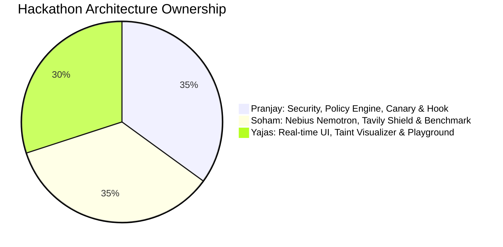

# 🤝 Team Work Distribution & Ownership Guide (team_work.md)

## Project: Agent Firewall
**Hackathon:** Nebius x NVIDIA Global AI Hackathon (with Tavily Integration)  
**Team Roster:**
1. **Pranjay** (Team Lead, Cybersecurity, AI/ML Light)
2. **Soham** (AI/ML, System Design)
3. **Yajas** (AI/ML, Frontend)

---

## 1. Executive Summary of Roles



| Member | Primary Focus | Modules Owned | Hackathon Judging Impact |
| :--- | :--- | :--- | :--- |
| **Pranjay** | Architecture Lead, Zero-Trust Policy Engine, Canary Egress Defense | `gateway/policy_engine.py`<br>`gateway/canary_inspector.py`<br>`gateway/taint_tracker.py`<br>`adapters/claude_code_hook.py` | Anchors the **"Potential Impact"** & **"Technological Implementation"** criteria (proves defense-in-depth). |
| **Soham** | Backend Infrastructure, Nebius Nemotron Serving, Tavily Intelligence | `intelligence/nebius_client.py`<br>`intelligence/injection_detector.py`<br>`intelligence/tavily_shield.py`<br>`benchmark/runner.py` | Anchors the **"Nebius & NVIDIA Criteria"** + **"$3,000 Tavily Sponsor Prize"**. |
| **Yajas** | Frontend Experience, WebSocket Stream, Attack Playground | `dashboard/index.html`<br>`dashboard/app.js`<br>`dashboard/styles.css`<br>`gateway/server.py` (WS routes) | Anchors the **"Design"** criterion (delivering a polished, visual product). |

---

## 2. Detailed Work Breakdown by Member

---

### 🛡️ 1. Pranjay (Lead, Cybersecurity, AI/ML Light)
**Core Responsibility:** Zero-trust security boundary, fail-closed mechanics, and project leadership.

#### Specific Deliverables:
1. **Policy Engine (`gateway/policy_engine.py`):**
   * Path scoping algorithm: Only allows read/write access strictly inside the designated project root (`cwd`).
   * Forbidden path blacklist: Hard blocks any access to `~/.ssh`, `~/.aws`, `~/.gnupg`, `**/.env*`, etc.
   * Fail-closed architecture: Ensures any internal unhandled exception defaults to `DENY`.
2. **Canary & Secret Scanner (`gateway/canary_inspector.py`):**
   * Generates unique synthetic canary tokens (`CANARY-FIREWALL-SECRET-XXXX`).
   * Multi-encoding scanner: Recursively inspects tool arguments in Plaintext, Hex, and Base64 representations.
   * Regex signatures for AWS keys, GitHub PATs, and SSH private key blocks.
3. **Session Taint Tracker (`gateway/taint_tracker.py`):**
   * Manages state transitions: `CLEAN` $\to$ `TAINTED` $\to$ `LOCKED`.
   * Enforces escalation rules (forces `ASK` on `git push` or network POST once tainted).
4. **Claude Code Hook Adapter (`adapters/claude_code_hook.py`):**
   * Builds the Python CLI script that handles Claude Code's `PreToolUse` event over `stdin`/`stdout`.
5. **Leadership & Submission Management:**
   * Keeps team on track across the 2+ day timeline.
   * Coordinates public GitHub repo setup, MIT License, and Devpost submission text.
   * Directs the 3-minute video presentation.

---

### 🧠 2. Soham (AI/ML, System Design)
**Core Responsibility:** Backend intelligence, Nebius Token Factory connection, Tavily integration, and the quantitative benchmark harness.

#### Specific Deliverables:
1. **Nebius Token Factory SDK Client (`intelligence/nebius_client.py`):**
   * Implements high-speed inference client connecting to Nebius Token Factory API (`https://api.tokenfactory.nebius.ai/v1`).
   * Connects to NVIDIA Nemotron models (Nano for fast edge screening, Super for borderline escalation).
   * Graceful mock fallback for offline/dry-run testing.
2. **Structured Injection Classifier (`intelligence/injection_detector.py`):**
   * Crafts robust system prompt instructing Nemotron to return structured JSON (`{is_injection, confidence, quoted_attack, reason}`).
   * Dual-tier logic: Auto-escalates to Nemotron Super when confidence is ambiguous (0.40 – 0.70).
3. **Tavily Security Shield (`intelligence/tavily_shield.py`):**
   * **Ingress Sanitizer:** Connects to Tavily Extract API to convert web pages into clean markdown, stripping script injections and hidden tracking pixels.
   * **Egress Domain Intel:** Connects to Tavily Search API to query domain context and flag disposable webhook sinks (`webhook.site`, pastebins).
4. **Evaluation Benchmark Suite (`benchmark/`):**
   * Creates 6 synthetic attack scenarios (README injection, poisoned skill, comment payload, render exfil, split instruction, supply chain) vs 3 benign developer tasks.
   * Builds the reproducible victim agent powered by Nemotron.
   * Generates quantitative metrics: Attack Success Rate (100% $\to$ 0%) and Canary Leak Rate (85% $\to$ 0%).

---

### 💻 3. Yajas (AI/ML, Frontend)
**Core Responsibility:** Delivering a "wow-factor" user experience to maximize the **Design** judging score.

#### Specific Deliverables:
1. **Real-Time Developer Web Console (`dashboard/`):**
   * Deep obsidian dark mode UI inspired by modern developer security platforms.
   * Built with lightweight, ultra-fast technologies (HTML5, Vanilla CSS Design Tokens, JavaScript).
   * Glassmorphism, neon security status badges, and zero layout shift.
2. **Live Telemetry & WebSocket Consumer (`dashboard/app.js`):**
   * Subscribes to the gateway's WebSocket feed (`ws://localhost:8000/ws`).
   * Live streaming feed of intercepted tool calls with real-time status pills: `ALLOW` (Green), `ASK` (Amber), `DENY` (Red).
   * Dynamic Taint Meter showing current session risk level.
3. **Event Inspection Drawer:**
   * Clicking any tool call in the feed smoothly slides out an analysis drawer showing:
     * Raw tool parameters.
     * Nemotron classification score and highlighted quote.
     * Tavily domain safety report.
     * Policy rule that fired.
4. **Interactive Attack Playground (Judge Showcase Mode):**
   * Pre-loads 4 one-click test attacks (Benign task, README injection, Stealth Base64 leak, Poisoned web link) so judges can test the system in seconds.
5. **Benchmark & Evaluation Tab:**
   * Renders side-by-side comparative charts showing the baseline vs protected metrics.

---

## 3. Team Collaboration Timeline (Multi-Day Schedule)

```text
Day 1: Foundation, Core Engine & API Clients
├── Pranjay: Policy engine, path scoping, canary generator & regex scanner
├── Soham: Nebius client (Nemotron Nano/Super) + Tavily client (Extract & Search)
└── Yajas: Scaffold dashboard UI, design tokens, and WebSocket connection

Day 2: Integration, Hook Adapter & Attack Playground
├── Pranjay: Claude Code PreToolUse hook adapter & session taint state machine
├── Soham: Benchmark runner with 6 attack families + victim agent
└── Yajas: Connect live event feed, build Event Inspector Drawer & Attack Playground

Day 3: Benchmarking, Video Recording & Submission Polish
├── Pranjay: Finalize README.md, MIT License, threat model docs, and coordinate video
├── Soham: Generate official benchmark numbers (ASR table, latency charts)
└── Yajas: Polish dashboard micro-animations, record live demo UI for video
```

---

## 4. Video Presentation Allocation (3-Minute Script)

* **0:00 - 0:45 (Pranjay):** The Problem — Explains the Lethal Trifecta in autonomous coding agents, how prompt injections steal SSH keys, and introduces Agent Firewall.
* **0:45 - 1:45 (Soham):** The Technology — Explains the Nebius Token Factory connection, NVIDIA Nemotron tiered models (Nano + Super), and how Tavily cleans web ingress and checks domain egress.
* **1:45 - 2:30 (Yajas):** Live Product Demo — Walks through the real-time dashboard, demonstrating:
  1. Benign task passing silently.
  2. Malicious README injection flagged and quoted by Nemotron.
  3. Sneaky Base64 secret leak blocked cold by the Canary Egress rule.
* **2:30 - 3:00 (Pranjay):** Quantitative Results & Wrap-up — Shows the benchmark metrics (ASR dropped from 94% to 0%), highlights open-source availability, and concludes.
